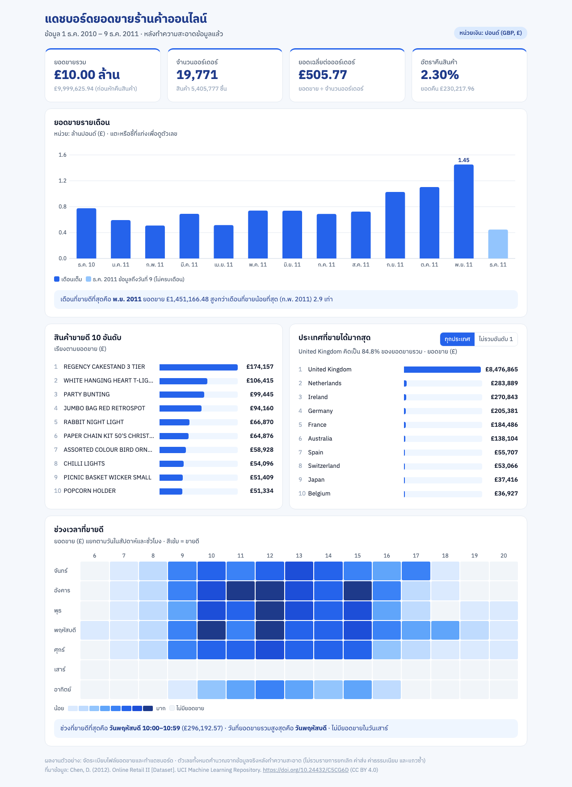
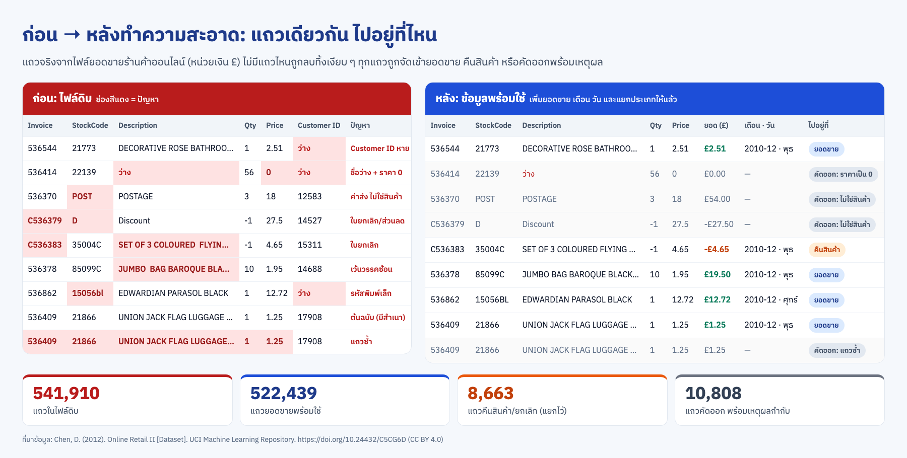
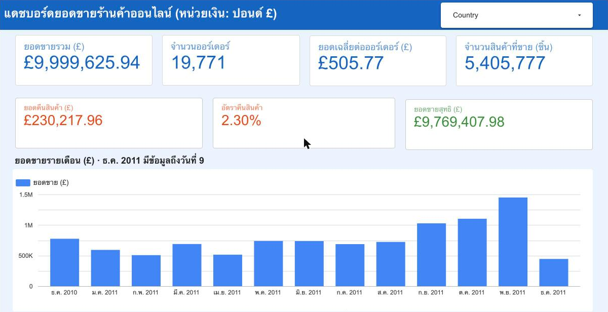
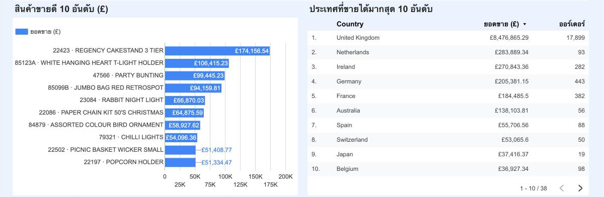
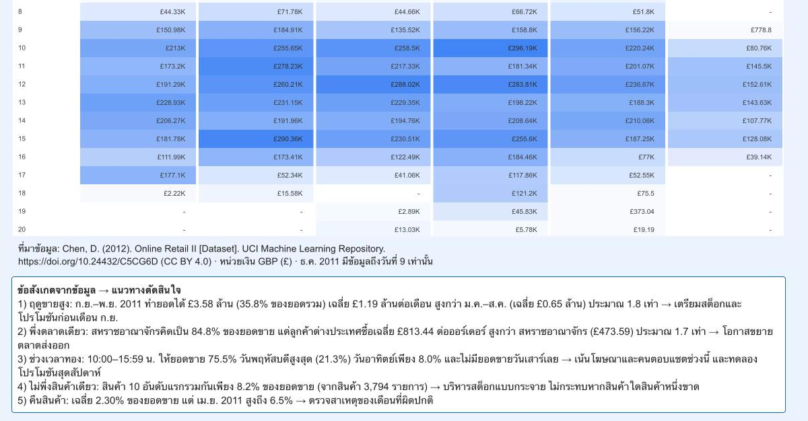
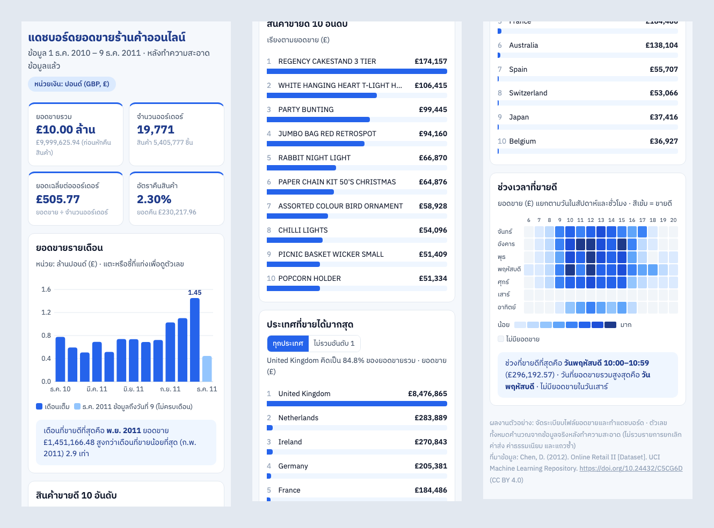
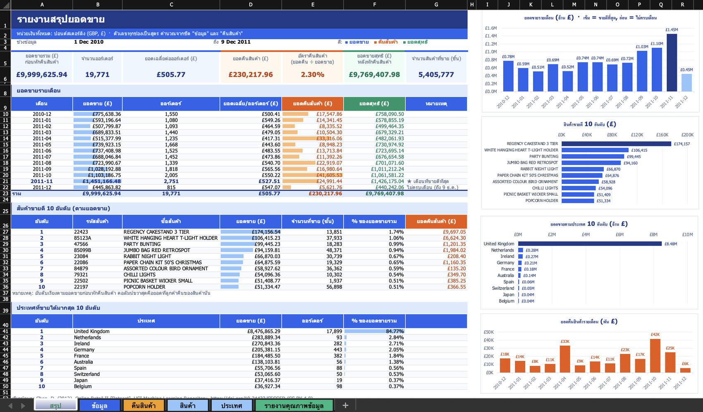
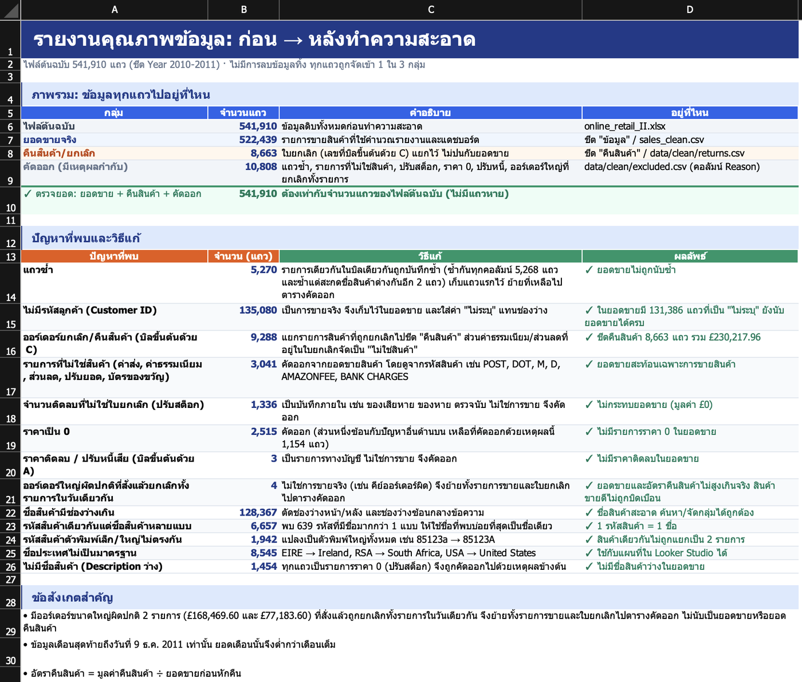

# Sales Data Cleanup + Dashboard (Portfolio Project)

A personal data-analytics project: turning a messy online-store sales export into **a clean dataset, an Excel report with live formulas, and a dashboard a non-technical shop owner can read at a glance.**

All figures are in **GBP (£)**.

**[View the live Looker Studio dashboard](https://datastudio.google.com/reporting/40d68cb5-a199-4516-911c-f0de41a53d7e)**



## The problem

Shop owners export sales from their store or marketplace and get a file like this: duplicated rows, missing customer IDs, cancelled orders mixed in with real sales, shipping fees and bank charges sitting in the product column, negative quantities, zero prices. Totals computed straight from that file are wrong, and nobody trusts them.

This project takes a real file of that kind (541,910 rows) and shows the whole path: **messy file → ready-to-use file → easy-to-read dashboard.**



## What I did

1. **Data audit** (`audit.py`): counted every kind of problem before touching anything.
2. **Cleaning** (`clean.py`): nothing is silently deleted. Every raw row ends up in exactly one of three tables, and excluded rows carry a reason column.
3. **Excel report** (`build_excel.py`): clean data + summary sheet built with real formulas (`SUMIFS`, `INDEX/MATCH`, `RANK`), so a shop owner can paste next month's data and the report updates itself. A Thai data-quality sheet documents every fix.
4. **HTML dashboard** (`build_dashboard.py`): one self-contained file, no libraries, works on phones.
5. **Looker Studio dashboard**: built from the same clean files, with a step-by-step Thai guide (`looker_studio_guide.md`).
6. **Consistency check** (`check_numbers.py`): confirms the key figures match across CSV, Excel, HTML and the written docs.

### Where each raw row goes

| Table | Rows | What it holds |
|---|---:|---|
| `sales_clean.csv` | 522,439 | Real product sales |
| `data/clean/returns.csv` | 8,663 | Cancelled / returned orders (invoice starts with `C`), kept apart from sales |
| `data/clean/excluded.csv` | 10,808 | Duplicates, non-product lines (postage, fees, discounts, gift vouchers), stock adjustments, zero-price lines, bad-debt entries, each with a `Reason` |
| **Total** | **541,910** | Equals the raw file: no row lost |

Main issues found in the raw data: 5,268 exact duplicate rows, 135,080 rows without a Customer ID, 9,288 cancelled-order rows, 2,996 non-product rows (33 codes), 2,515 zero-price rows, 113,452 descriptions with stray spaces, and 639 stock codes with more than one description.

Two decisions worth noting:

- **Rows without a Customer ID are kept** as real sales (labelled `ไม่ระบุ` / "unspecified"). They are genuine revenue.
- **Two huge orders (£168,469.60 and £77,183.60) were placed and fully cancelled the same day.** Counting them would inflate sales by about £246k and the return rate from 2.30% to 4.64%, so both the sale and its cancellation are moved to the excluded table. Smaller same-day cancellations stay in sales and returns as normal.

## Results

| Metric | Value |
|---|---:|
| Total sales (before returns) | £9,999,625.94 |
| Orders | 19,771 |
| Average order value | £505.77 |
| Units sold | 5,405,777 |
| Returns | £230,217.96 (2.30% of sales) |
| Net sales | £9,769,407.98 |
| Period | 1 Dec 2010 – 9 Dec 2011 (Dec 2011 is a partial month) |

A few things the dashboard makes visible: Sep–Nov 2011 brought in 35.8% of the year's sales; the UK is 84.8% of sales but overseas customers spend about 1.7x more per order; 75.5% of sales happen between 10:00 and 15:59; and the ten best-selling products together make up only 8.2% of sales.

### Dashboard (Looker Studio)

The same clean data powers an interactive Looker Studio dashboard (KPI cards, monthly sales, top products and countries, a weekday-by-hour heatmap, and a short "what the data says" box): **[open it here](https://datastudio.google.com/reporting/40d68cb5-a199-4516-911c-f0de41a53d7e)**. The Thai step-by-step build guide is in `looker_studio_guide.md`.







### Dashboard (HTML)


`dashboard.html` is a single file: open it in any browser. Charts are plain SVG/CSS, with tooltips on hover or tap.

On a phone:



### Excel report

`sales_report.xlsx` has six sheets: Summary (KPIs, monthly table, top products, top countries, charts), Data, Returns, helper sheets for ranking, and a Thai data-quality report. Every number on the summary sheet is a formula over the data sheets. Colours are consistent everywhere: blue = sales, orange = returns, green = net.





## How to run

Requires Python 3.10+ and (for the images only) Google Chrome.

```bash
python3 -m venv .venv && .venv/bin/pip install -r requirements.txt

# 1. download the dataset (see "Data" below) and unzip it to data/raw/online_retail_II.xlsx
.venv/bin/python audit.py            # -> reports/audit_summary.json
.venv/bin/python clean.py            # -> sales_clean.csv, data/clean/*.csv, reports/clean_summary.json
.venv/bin/python build_excel.py      # -> sales_report.xlsx
.venv/bin/python build_dashboard.py  # -> dashboard.html
.venv/bin/python build_images.py     # -> images/*.png (needs Google Chrome)
.venv/bin/python check_numbers.py    # cross-checks the key figures across all outputs
```

The first read of the raw Excel file takes a minute or two; it is cached afterwards.

> `sales_clean.csv` (about 73 MB) and `sales_report.xlsx` (about 35 MB) are large, so they are generated by the scripts above rather than committed to Git.

## Project layout

```
audit.py / clean.py            data audit and cleaning
build_excel.py                 Excel report (xlsxwriter, real formulas)
build_dashboard.py             single-file HTML dashboard
build_images.py                cover, before/after and dashboard screenshots
check_numbers.py               cross-file consistency check
looker_studio_guide.md         Thai step-by-step Looker Studio guide
reports/                       numbers behind every output (JSON)
images/                        portfolio images
```

## Data

Chen, D. (2012). *Online Retail II* [Dataset]. UCI Machine Learning Repository. https://doi.org/10.24432/C5CG6D

Licensed under [CC BY 4.0](https://creativecommons.org/licenses/by/4.0/). Only the `Year 2010-2011` sheet is used. Download: https://archive.ics.uci.edu/static/public/502/online+retail+ii.zip

The data belongs to its original publishers and is used here for demonstration; the code and write-ups in this repository are my own work.
